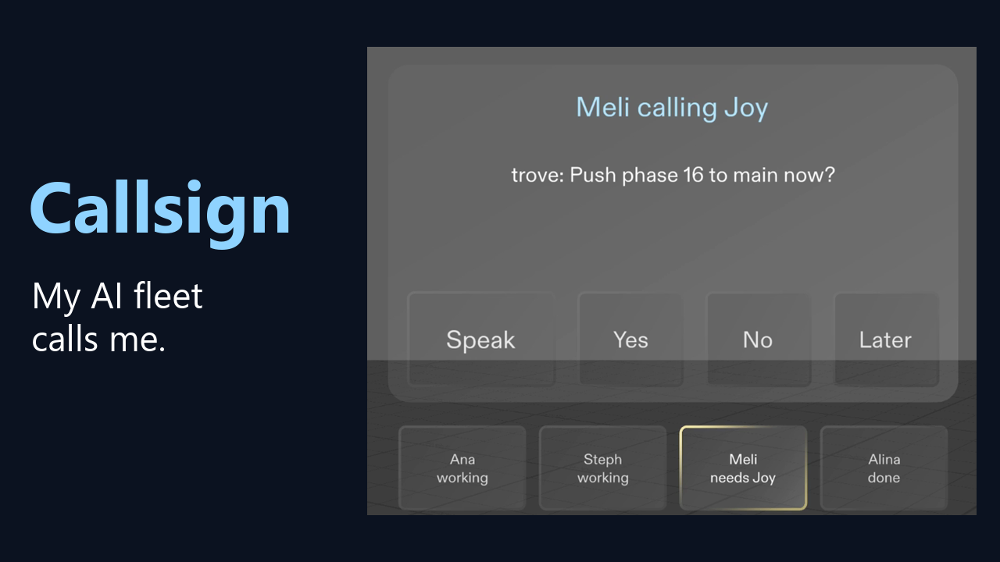
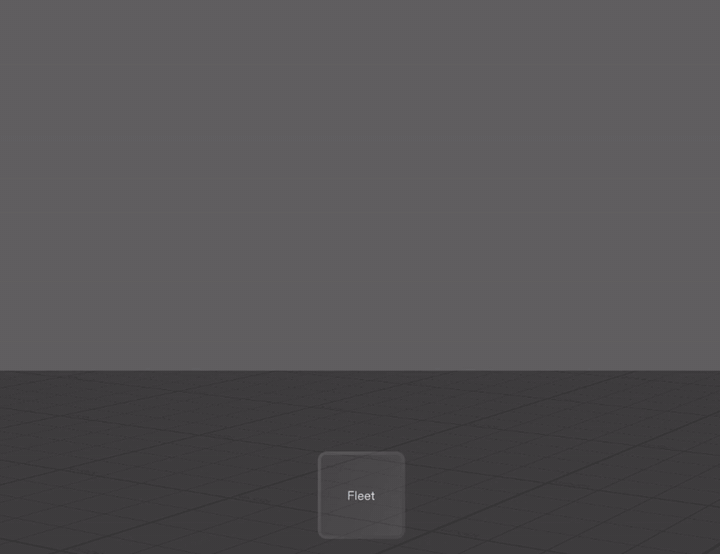
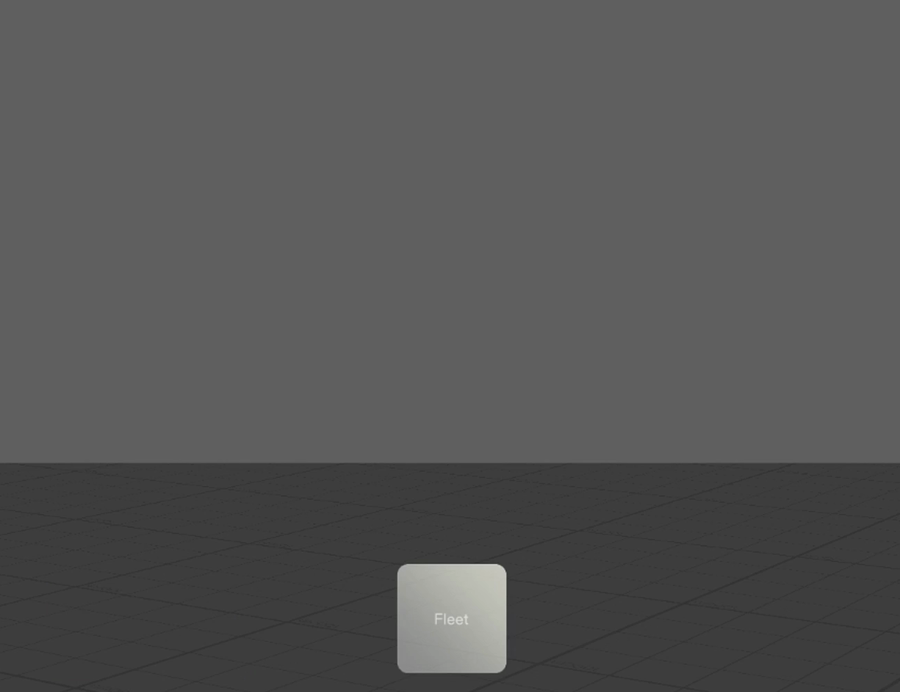
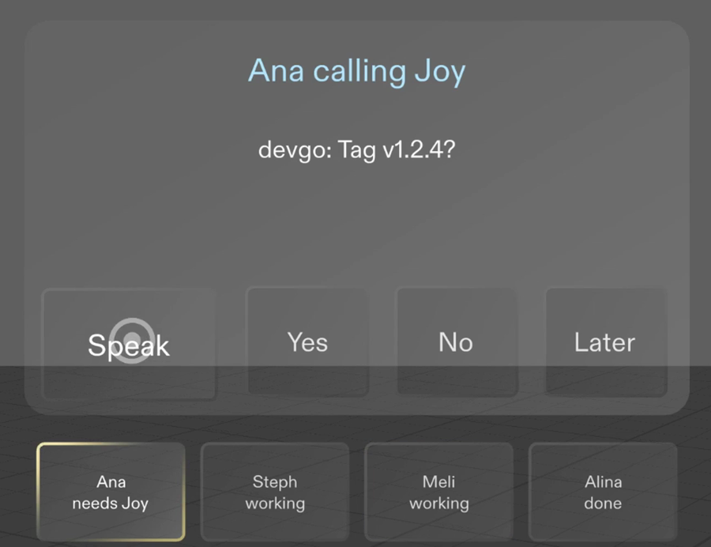

# Callsign

**My AI coding sessions call me by name in my Snap Specs, and I answer out loud without leaving my workout.**

  <a href="https://youtu.be/O3RnAPA3Tmw"><b>Watch the demo (2:14)</b></a> ·
  <a href="https://devpost.com/software/callsign-your-ai-fleet-calls-you-you-answer-hands-free">Devpost</a> ·
  Built for <a href="https://learn-specs.devpost.com/">Learn AR with SPECS</a>

## Why I built it

I run four AI coding sessions on three machines and each one has a name. When one of them needs me, it stops and waits for an answer.

If I'm working out, I have to stop, walk to the desk, type the answer and walk back. That happens many times a day, so I built a Lens that brings the question to me instead.

## How it works

  

Nothing shows until a machine needs me. Then I hear a chime and the machine calls me by name, like "Meli calling Joy", and a card shows me the question. I answer out loud, or I pinch Yes, No or Later. The card says who it went to and gets out of the way.

Below the card there's a row with all four callsigns, so I can see who is working and who needs me. I can pinch any of them to see what that machine is doing.

| Quiet until someone needs me | Ana calls next |
|:---:|:---:|
|  |  |

## The fleet

Each machine calls in its own voice, so I know who it is before I look.

| Callsign | Where it runs | Voice |
|---|---|---|
| Steph | my PC, Windows | Ava |
| Ana | my PC, WSL | Emily |
| Meli | my Mac | Natasha |
| Alina | my Ubuntu Server | Amy |

I made the call clips with Microsoft Edge neural voices and Piper, because text-to-speech in Lens Studio is deprecated.

## Run it

1. Open `specs-lens.esproj` in Lens Studio 5.23.2 (5.22 or later works).
2. Press Preview. Meli calls first.
3. Press Speak to answer by voice, or pinch Yes, No or Later. In the preview there's no mic, so the Speak button stands in for my voice.

The questions are sample data for now, in `Assets/Scripts/CallsignFleetData.ts`.

## How I built it

I planned it with the `plan-lens` skill, and the brief it wrote is in [`devpost/design-brief.md`](devpost/design-brief.md). Then Snap's CLAD agents built it in Lens Studio from that brief, using Spectacles Interaction Kit 2.0.0 and UI Kit.

Every done criterion in the brief has a LEAF test, and all 6 pass in the preview (LEAF 2.0.2).

A few things I learned on the way:

- The display is additive, so black is invisible. Every panel uses light text on a light-grey glass plate.
- The preview shows less above and below centre than I expected. With the card 15 cm below eye level the machine row fell out of view, so the card sits 3 cm below.
- LEAF 4 needs Interaction Kit 4, and the template ships 2.0.0, so I used LEAF 2.0.2 to match.

## What's next

A small relay that my sessions post to, so the Lens shows the real questions instead of sample ones.

The full Devpost write-up is in [`devpost/submission.md`](devpost/submission.md).
